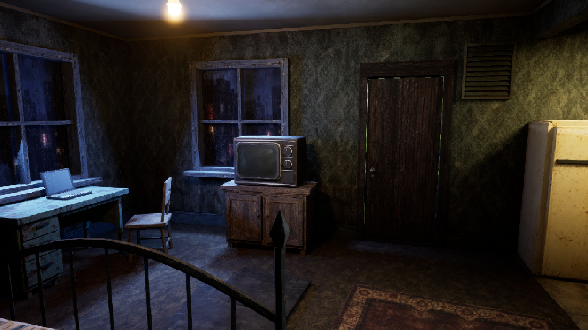
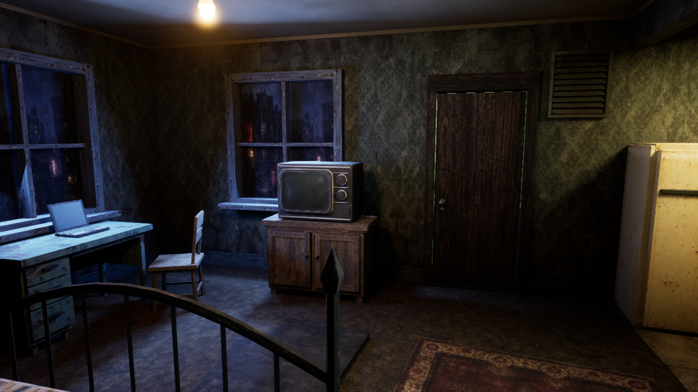
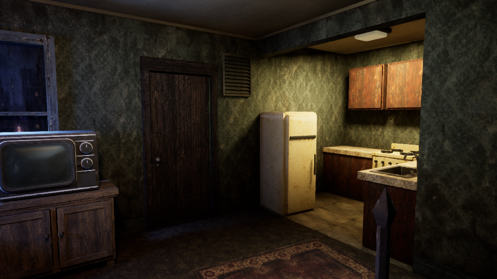

# UE5 Simply-PSX

A small PSX-style rendering plugin for Unreal Engine 5. Pixelation, vertex wobble, affine texture mapping, and optional color reduction and dithering, controlled by one actor.

The default is a subtle 540p look. Every effect has its own toggle, and the resolution and strengths are adjustable.

## Setup

Built for **Unreal Engine 5.8**. This is a source plugin, so you'll need a C++ project and a working Unreal C++ toolchain.

1. Copy `Plugins/SimplyPSX` into your project's `Plugins` folder.
2. Regenerate project files and build your project's **Development Editor** target.
3. Open the project, enable **UE5 Simply-PSX** under **Edit → Plugins**, and restart if prompted.
4. Find **Simply PSX Controller** in Place Actors and add one to your level.

Pixelation works immediately. Geometry wobble and texture warping need compatible materials; see [material setup](docs/Materials.md).

The materials are included.

## Controls

Select the controller and open **PSX** in Details. Changes preview in the editor. Save the level to keep them.

| Setting | What it does |
| --- | --- |
| Enable PSX | Switches the whole system on or off. |
| Preset | Subtle 540p, Balanced 360p, or Chunky 240p. Editing a setting changes this to Custom. |
| Pixel Height | Virtual vertical resolution, from 64 to 4320. Width follows the viewport's aspect ratio. |
| Geometry Wobble | Snaps vertices to a screen-space grid. Strength and grid resolution are separate controls. |
| Texture Warping | Blends perspective-correct textures toward affine mapping. |
| Color Reduction | Reduces precision to 2–8 bits per RGB channel. |
| Dithering | Adds an ordered dither pattern, with its own strength control. |

Subtle uses a 540p grid, wobble and warp strengths of 0.15, and leaves color reduction and dithering off. At 16:9, the pixel grid is approximately 960 × 540; the display resolution stays unchanged.

Keep one controller per world, including streamed levels. **Is Active Controller** shows which controller owns the effect if more than one is present.

## Apartment preview

Same camera, with the effect off and with Subtle 540p. Open the images at full size to see the difference.

| Off | Subtle 540p |
| --- | --- |
|  |  |

Captured in the Noir Night apartment at 1920 × 1080. The environment is shown as an example and isn't included in the plugin.

## Blueprint use

Keep a reference to the controller:

- **Set Enabled** changes the master switch and applies it immediately.
- **Apply Preset** applies a complete preset.
- **Apply Settings** publishes values after you change properties at runtime.

The controller doesn't tick every frame. Removing it clears its effects.

## Compatibility

Tested on Windows with UE 5.8.4, using desktop SDR rendering. Older engine versions, other platforms, HDR, VR, and split-screen haven't been verified.

Pixelation is a post-process effect. It doesn't reduce the scene's actual render resolution or promise a performance gain. Wobble and texture warping affect rendering, not mesh data or collision. Screen-space UMG is drawn separately; world-space UI is part of the scene.

[Material setup](docs/Materials.md) · [Development and validation](docs/Development.md)
